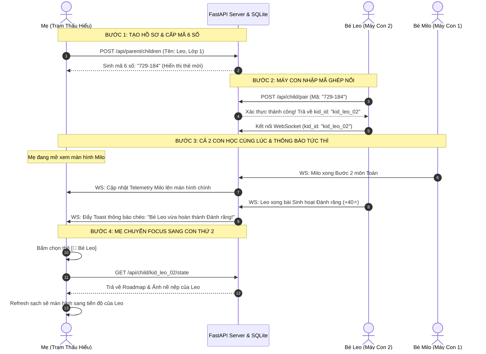

# KẾ HOẠCH NÂNG CẤP HỆ THỐNG: QUẢN LÝ NHIỀU CON & ĐỒNG BỘ THỜI GIAN THỰC (MULTI-CHILD MANAGEMENT & STREAMING SYNC)

> **Nhánh Git:** `children_management`  
> **Phiên bản:** v2.0-multi-child  
> **Mục tiêu:** Chuyển đổi từ mô hình 1 Mẹ - 1 Con (lưu RAM/LocalStorage) sang mô hình **Gia đình Đa Con (Multi-Child Hub)**: Mẹ quản lý nhiều hồ sơ bé, ghép nối máy con qua **Mã PIN 6 số**, dữ liệu độc lập bền vững với **SQLite**, và truyền nhận luồng thông báo song song không gián đoạn.

---

## 1. Ý TƯỞNG CỐT LÕI (CORE CONCEPT)

1. **Cơ Chế Ghép Nối 6 Số (6-Digit Child Pairing Code):**
   - Phụ huynh tạo hồ sơ con (Tên bé, khối lớp, độ nhạy ADHD).
   - Hệ thống tự sinh mã 6 số ngẫu nhiên dạng `ABC-123` hoặc `729-184` (hạn dùng 15-30 phút hoặc cố định theo hồ sơ).
   - Máy của con chỉ cần mở app, gõ 6 số ➔ Tự động ghép nối vào gia đình, không cần tài khoản hay mật khẩu phức tạp.

2. **Tách Biệt Dữ Liệu Tuyệt Đối (Data Isolation Per Child):**
   - Mỗi bé có một không gian độc lập: Lộ trình bài tập (`childRoadmap`), Thói quen sinh hoạt (`childRoutineRoadmap`), Lịch sử ảnh minh chứng nề nếp (`routinePhotoProofs`), Số sao thưởng tích lũy (`stars`), và Hồ sơ nhận thức ADHD (`cognitiveProfile`).
   - Mẹ giao bài cho Bé 1 không ảnh hưởng đến lộ trình của Bé 2.

3. **Luồng Thông Báo Đồng Thời (Concurrent Real-Time Notification Stream):**
   - Khi cả 2 con cùng ngồi học song song, máy phụ huynh nhận được luồng sự kiện từ cả 2 bé theo thời gian thực.
   - Nếu mẹ đang xem màn hình Bé 1 mà Bé 2 làm xong bài hoặc xin đổi vé vàng, hệ thống hiển thị **Thông Báo Nổi (Cross-Child Toast)** ở góc màn hình mà không làm xáo trộn màn hình Bé 1.

4. **Bền Vững Hóa Dữ Liệu Với SQLite (Zero-Config Persistence):**
   - Thay thế hoàn toàn việc lưu dữ liệu tạm trên RAM của Python và `localStorage` trình duyệt.
   - Mọi tiến độ, số sao, lịch sử ảnh được lưu vào 1 file database duy nhất: `data/family_milo.db`. Tắt máy, mất mạng, khởi động lại server vẫn bảo toàn 100% dữ liệu.

---

## 2. CÁC THAY ĐỔI CẦN THỰC HIỆN (PLANNED IMPLEMENTATIONS)

### 2.1. Tầng Cơ Sở Dữ Liệu (SQLite Database)
- Xây dựng module `src/api/db.py` với SQLite (kích hoạt `PRAGMA journal_mode=WAL` để đọc/ghi cực nhanh, chống khóa).
- **Các bảng chính:**
  1. `parents`: Lưu thông tin phụ huynh (`parent_id`, `name`, `family_code`).
  2. `children`: Lưu hồ sơ từng bé (`kid_id`, `parent_id`, `name`, `grade`, `avatar`, `stars`, `cognitive_profile_json`).
  3. `pairing_codes`: Lưu mã ghép nối tạm thời (`code`, `kid_id`, `parent_id`, `created_at`, `expires_at`, `is_used`).
  4. `child_roadmaps`: Lưu danh sách bài tập GDPT 2018 đang giao cho từng bé.
  5. `child_routines`: Lưu danh sách thói quen sinh hoạt và ảnh minh chứng của từng bé.
  6. `activity_logs`: Lưu nhật ký sự kiện telemetry và hoàn thành bài theo từng bé.

### 2.2. Tầng Backend API & WebSocket (`src/api/server.py`)
- **API REST mới:**
  - `POST /api/parent/children`: Phụ huynh tạo hồ sơ con mới.
  - `GET /api/parent/children`: Lấy danh sách tất cả các con của phụ huynh.
  - `POST /api/parent/children/{kid_id}/pairing-code`: Sinh mã 6 số để ghép nối cho con.
  - `POST /api/child/pair`: Máy con gửi mã 6 số để xác thực và nhận profile.
  - `GET /api/child/{kid_id}/state`: Lấy đầy đủ trạng thái (State Hydration) của một bé cụ thể.
- **WebSocket `/ws/sync` Nâng Cấp:**
  - Định danh kết nối: `ws/sync?family_id={family_id}&role={role}&kid_id={kid_id}`.
  - Mọi gói tin gửi qua WebSocket đều có header chuẩn:
    ```json
    {
      "family_id": "fam_lan_01",
      "kid_id": "kid_leo_02",
      "event_type": "KID_STEP_COMPLETED",
      "payload": { "step_id": 2, "points": 25 }
    }
    ```
  - Server broadcast tới phụ huynh kèm `kid_id` để client phụ huynh phân loại luồng.

### 2.3. Tầng Client State & Đồng Bộ (`app/js/sync_bus.js` & `app/js/state.js`)
- `MiloSyncBus`: Mở rộng hỗ trợ lọc event theo `kid_id`.
- `appState`: Chuyển sang mô hình đa con:
  - `appState.activeChildId`: ID của con đang được hiển thị trên giao diện mẹ.
  - `appState.children`: Từ điển cache dữ liệu của từng con `{ "kid_01": {...}, "kid_02": {...} }`.
  - Hàm `switchActiveChild(targetKidId)`: Nạp dữ liệu của bé được chọn và gọi lại toàn bộ các hàm render UI.

### 2.4. Tầng Giao Diện (Frontend UI)
- **Trên Trạm Thấu Hiểu (Máy Phụ Huynh):**
  - **Child Switcher Bar**: Thanh chuyển đổi bé nằm ở đỉnh ứng dụng (Avatar, tên bé, khối lớp, huy hiệu trạng thái online/offline).
  - **Nút "+ Thêm Bé Mới"**: Modal nhập thông tin và sinh ra mã QR / 6 số lớn để con nhập.
  - **Cross-Child Toast Alert**: Cửa sổ thông báo nổi ở góc khi bé khác có sự kiện (làm bài xong, xin vé vàng).
- **Trên Milo Quest (Máy Của Con):**
  - **Màn hình Nhập Mã 6 Số (Child Onboarding Pinpad)**: Xuất hiện lần đầu khi mở app trên máy mới. Thiết kế ô số lớn, âm thanh clicky vui nhộn. Sau khi nhập thành công sẽ lưu ID vào `localStorage` và không phải nhập lại.

---

## 3. CÁC FILE SẼ BỊ THAY ĐỔI VÀ TẠO MỚI (AFFECTED FILES)

| File | Hành động | Mục đích |
| :--- | :---: | :--- |
| `src/api/db.py` | **TẠO MỚI** | Module quản lý SQLite, khởi tạo Schema, CRUD bảng phụ huynh, con, mã ghép nối, tiến độ bài tập. |
| `src/api/server.py` | **SỬA ĐỔI** | Tích hợp SQLite, thêm các API ghép nối/quản lý con, nâng cấp WebSocket endpoint hỗ trợ đa con. |
| `app/js/sync_bus.js` | **SỬA ĐỔI** | Bổ sung `kid_id` vào Envelope tin nhắn, hỗ trợ subscribe lọc theo bé. |
| `app/js/state.js` | **SỬA ĐỔI** | Bổ sung `appState.activeChildId`, cơ chế chuyển đổi Profile con `switchActiveChild()`. |
| `app/js/parent_survey.js` | **SỬA ĐỔI** | Bổ sung bộ điều khiển chọn con (Child Switcher Controller) và Modal cấp mã 6 số. |
| `app/js/renderers.js` | **SỬA ĐỔI** | Cập nhật các hàm render giao diện để nhận dữ liệu từ hồ sơ con đang chọn. |
| `app/index.html` | **SỬA ĐỔI** | Thêm UI Child Switcher Bar, Modal thêm con & hiển thị mã 6 số, Màn hình nhập PIN trên máy con. |
| `app/css/style.css` | **SỬA ĐỔI** | Bổ sung style cho bàn phím nhập PIN 6 số và thanh chuyển đổi con. |
| `tests/test_multi_child_sync.py` | **TẠO MỚI** | Bộ kiểm thử tự động: Sinh mã 6 số, ghép đôi con 1 và con 2, gửi nhận sự kiện đồng thời. |

---

## 4. LUỒNG HOẠT ĐỘNG SAU KHI SỬA (END-TO-END DATA FLOW)



---

## 5. CẤU TRÚC THƯ MỤC DỰ ÁN MỤC TIÊU (TARGET FOLDER STRUCTURE)

```
calm-bardeen/
├── app/                                # Frontend ứng dụng web
│   ├── css/
│   │   └── style.css                   # Định kiểu giao diện (bổ sung Pinpad & Switcher UI)
│   ├── js/
│   │   ├── app.js                      # Điểm khởi chạy chính ứng dụng
│   │   ├── audio.js                    # Hiệu ứng âm thanh dopamine
│   │   ├── decomposer_fallback.js      # Bộ băm bài dự phòng phía client
│   │   ├── geometry.js                 # Vẽ hình SVG hình học tương tác
│   │   ├── parent_survey.js            # Quản lý Trạm Thấu Hiểu & Bộ chọn con (Child Switcher)
│   │   ├── renderers.js                # Render các bài tập & micro-steps
│   │   ├── rewards_timer_milo.js       # Đồng hồ thị giác & đổi quà vé vàng
│   │   ├── roadmap.js                  # Lộ trình học tập & thói quen sinh hoạt
│   │   ├── state.js                    # Quản trị State tập trung (Multi-Child state)
│   │   ├── sync_bus.js                 # Bus truyền thông tin (Tri-layer WebSocket/LocalBus)
│   │   └── tasks_data.js               # Dữ liệu bài tập nạp sẵn
│   └── index.html                      # Giao diện chính (Milo Quest + Trạm Thấu Hiểu)
├── data/
│   ├── curriculum/
│   │   ├── tasks_db.json               # 25 bài GDPT 2018 + 4 bài sinh hoạt (Read-only Single Source)
│   │   └── routines_db.json            # 12 thói quen sinh hoạt mẫu
│   └── family_milo.db                  # [MỚI] SQLite Database lưu trữ bền vững phụ huynh & các con
├── prompts/
│   └── micro_task_decomposer.md        # Prompt AI băm vi nhiệm vụ chuẩn mực
├── src/
│   ├── adhd_scoring/                   # Đánh giá hồ sơ nhận thức ADHD
│   │   └── scoring_service.py
│   └── api/
│       ├── ai_engine.py                # Gemini AI Engine băm bài học
│       ├── db.py                       # [MỚI] SQLite Storage Engine & Data Models
│       ├── routine_models.py           # Mô hình Pydantic cho thói quen
│       └── server.py                   # FastAPI Server, REST APIs & Multi-Child WebSocket Sync
├── tests/
│   ├── e2e/                            # Kiểm thử luồng tích hợp E2E
│   ├── test_api_server.py              # Kiểm thử API server
│   └── test_multi_child_sync.py        # [MỚI] Kiểm thử đồng bộ ghép nối đa con
├── AGENTS.md                           # Quy tắc phát triển dành cho AI Agent
├── plan.md                             # [FILE NÀY] Kế hoạch triển khai kiến trúc Đa Con
└── run.bat                             # 1-Click khởi chạy hệ thống toàn diện
```

---

## 6. TIÊU CHÍ HOÀN THÀNH (ACCEPTANCE CRITERIA)

1. [ ] **Ghép nối 1-chạm:** Mẹ tạo con thứ 2 nhận được mã 6 số. Mở trình duyệt ẩn danh hoặc thiết bị khác nhập mã 6 số là máy con tự động đồng bộ ngay lập tức.
2. [ ] **Tách biệt dữ liệu:** Con 1 học Toán Lớp 3, Con 2 làm nề nếp Lớp 1 ➔ Bài tập và số sao của hai bên không bị ảnh hưởng lẫn nhau.
3. [ ] **Chuyển đổi tức thì:** Mẹ bấm chuyển giữa Con 1 và Con 2 trên Trạm Thấu Hiểu, toàn bộ cửa sổ Task, Giám sát nhịp Telemetry, và Thư viện ảnh nề nếp tự động refresh sang đúng dữ liệu của con đó.
4. [ ] **Thông báo song song:** Cả 2 con cùng thao tác bài tập, máy mẹ nhận đủ sự kiện và hiển thị thông báo góc màn hình đúng tên từng bé.
5. [ ] **Bền vững 100%:** Tắt hoàn toàn `run.bat` và mở lại, mọi tài khoản con, sao thưởng và lộ trình vẫn được SQLite bảo toàn nguyên vẹn.
